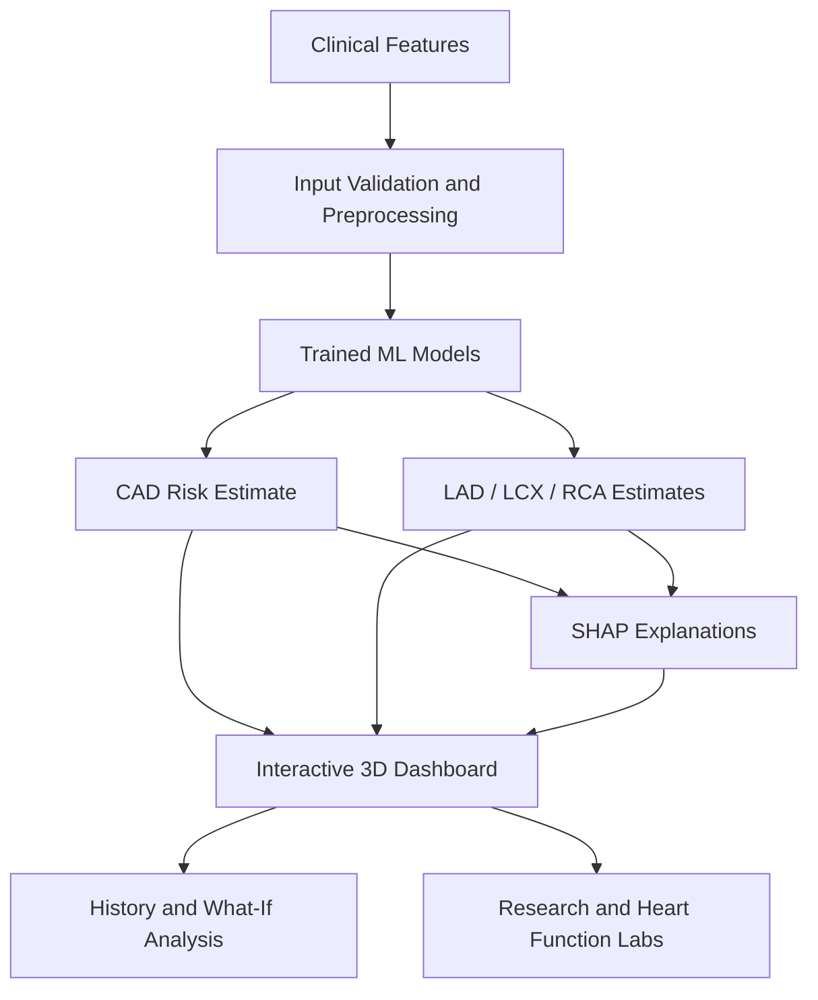

# 🫀 CardioMap 3D

An AI-powered coronary artery disease (CAD) risk prediction and research platform featuring interactive 3D heart visualization, explainable AI, and research tools.

🌐 **[Live Demo](https://cardiomap-3d.onrender.com/app)** · 📚 **[API Documentation](https://cardiomap-3d.onrender.com/docs)** · 💻 **[Source Code](https://github.com/priyanshu2734/cardiomap-3d)**

> **Disclaimer:** For educational and research purposes only. Not intended for clinical diagnosis or treatment decisions.
### Explainable AI for Coronary Artery Disease Research & 3D Visualization

**CardioMap 3D** is an AI-powered research and educational platform that explores coronary artery disease (CAD) risk prediction through machine learning, explainable AI, and interactive 3D cardiac visualization.

The platform estimates overall CAD risk and vessel-level stenosis probabilities for the **Left Anterior Descending (LAD), Left Circumflex (LCX), and Right Coronary Artery (RCA)** using clinical features. It combines these estimates with SHAP-based explanations, uncertainty ranges, model evaluation tools, and interactive heart-function simulations.

> ⚠️ **Research and education only.** CardioMap 3D is an experimental prototype, not a medical device. Its predictions, visualizations, and simulations are not clinical diagnoses and must not be used to make medical decisions.

---

## ✨ Key Features

### 🧠 1. Machine Learning & Risk Estimation

- Predicts overall coronary artery disease risk and estimates for LAD, LCX, and RCA.
- Evaluates Logistic Regression, Random Forest, and Gradient Boosting models.
- Selects models using cross-validation and ROC-AUC.
- Applies imputation and scaling within cross-validation folds to reduce data leakage.
- Provides probability estimates and bootstrap-based uncertainty ranges.

### 🔬 2. Explainable AI with SHAP

- Explains individual predictions using SHAP.
- Identifies the features contributing most to a model's output.
- Displays global feature-importance information.
- Helps users investigate *why* a model produces a particular estimate rather than presenting a prediction alone.

### ❤️ 3. Interactive 3D Heart Visualization

- Explore a 3D heart model with rotation and zoom controls.
- Select LAD, LCX, or RCA to inspect vessel-specific estimates.
- Visualize predicted probabilities through vessel colors.
- Explore uncertainty indicators and typical myocardial territories.

**Important:** The coronary vessels are schematic paths, not patient-specific anatomy. The platform does not locate real blockages from medical scans.

### 🧪 4. Cardiac Research Lab

The Research Lab supports experiments for investigating model behavior and limitations.

- **Feature ablation:** Explore how groups of clinical features affect ranking performance.
- **Model comparison:** Compare Logistic Regression, Random Forest, and Gradient Boosting.
- **Weak-vessel analysis:** Investigate why LCX and RCA predictions are less reliable.
- **Subgroup analysis:** Examine descriptive results across age and sex groups.
- **Calibration analysis:** Investigate the relationship between model scores and observed outcomes.

Experiments use repeated, stratified nested cross-validation, paired bootstrap confidence intervals, reproducible seeds, and experiment manifests.

### 🫀 5. Heart Function Lab

An interactive educational environment for exploring simplified coronary physiology.

- Simulates coronary flow under resting and exercise demand.
- Adjusts example vessel narrowings and compares their effects.
- Explores flow reserve, pressure-drop concepts, and illustrative ECG changes.
- Includes educational heart-motion and physiology visualizations.
- Supports comparisons between simulated behavior and descriptive cohort statistics.

The physiology and ECG components are simplified teaching models, not validated patient-specific simulations.

### 🛡️ 6. Trust, History & Interactive Tools

- **Prediction history:** Review previous interactions and export records as CSV or JSON.
- **What-If analysis:** Explore hypothetical input changes.
- **Digital Twin:** Investigate interactive, model-driven scenarios.
- **AI Detective and Stress Test:** Access additional model-investigation workflows.
- **Trust Center and Validation Report:** Explore model behavior, transparency, and limitations.
- **Optional AI assistant:** Configure a supported Groq or NVIDIA provider for AI-assisted interaction.

Prediction history is stored locally in the browser using `localStorage`; it is not uploaded to the server by the history recorder.

---

## 🏗️ How It Works



The application separates model logic, API handling, visualization, and research workflows.

- **Python:** Data processing, model inference, evaluation, and research logic.
- **FastAPI:** Application routes and prediction API.
- **HTML, CSS, and JavaScript:** Interactive user interface and visualization tools.
- **Three.js:** Browser-based 3D visualization.
- **scikit-learn:** Machine learning and model evaluation.
- **SHAP:** Prediction explanations.
- **Bootstrap resampling:** Uncertainty estimation and research analysis.

---

## 📊 Model Evaluation

The dashboard models were evaluated on **303 records** using repeated nested cross-validation: five outer folds repeated three times, with model selection performed inside the training folds.

| Prediction target | Selected model | Accuracy | ROC-AUC |
|---|---|---:|---:|
| Overall CAD | Gradient Boosting | 0.87 | 0.92 |
| LAD | Random Forest | 0.79 | 0.85 |
| LCX | Random Forest | 0.69 | 0.73 |
| RCA | Logistic Regression | 0.67 | 0.71 |

These are experimental results from a single dataset, not evidence of clinical effectiveness.

**Interpretation matters:**

- Overall CAD performed better than the individual vessel predictions in this evaluation.
- LCX and RCA estimates were comparatively weak.
- The dataset is small and comes from a cohort of patients already referred for angiography.
- There is no external validation, and results may not generalize to other populations.
- A model's predicted score should not automatically be interpreted as a well-calibrated real-world probability.

For detailed methodology and additional experiments, see the project's `docs/` directory and `metrics.json`.

---

## 🚀 Getting Started

### Prerequisites

- Python 3.11 or newer
- Git
- A terminal and a modern web browser

Python 3.12 has also been used to test the project.

### 1. Clone the repository

```bash
git clone https://github.com/priyanshu2734/cardiomap-3d.git
cd cardiomap-3d
```

### 2. Create a virtual environment

**Windows — PowerShell:**

```powershell
python -m venv .venv
.\.venv\Scripts\Activate.ps1
```

**Windows — Git Bash:**

```bash
python -m venv .venv
source .venv/Scripts/activate
```

### 3. Install dependencies

```bash
python -m pip install --upgrade pip
pip install -r requirements.txt
```

### 4. Launch the application

```bash
python run_demo.py
```

The launcher checks the required dependencies and model files, then starts the application. If the bundled model is incompatible with the installed scikit-learn version, it can trigger a model rebuild.

### 5. Open CardioMap 3D

Navigate to:

**http://127.0.0.1:8000/app**

Additional pages and tools are available through the application's navigation.

### Optional: Retrain the models

If you want to rebuild the models and derived files manually:

```bash
python train.py data.xlsx --rebuild-extras
```

A quicker training path is available:

```bash
python train.py data.xlsx --quick
```

The quick option skips nested validation. Retraining may take several minutes, depending on the machine and installed dependencies.

---

## 🔌 API Reference

CardioMap exposes HTTP endpoints for prediction, explanations, health checks, metrics, and schema information.

| Method | Endpoint | Purpose |
|---|---|---|
| `GET` | `/health` | Check application health |
| `GET` | `/schema` | Inspect prediction input schema |
| `GET` | `/metrics` | Retrieve model evaluation metrics |
| `GET` | `/audit` | Access audit information |
| `GET` | `/shap/global` | Retrieve global feature importance |
| `POST` | `/predict` | Generate predictions, uncertainty ranges, and explanations |
| `POST` | `/explain` | Generate SHAP explanations |

Interactive API documentation is available at:

**http://127.0.0.1:8000/docs**

For deployments, configure `CARDIOMAP_ORIGINS` to restrict allowed cross-origin requests.

---

## 🔐 Optional AI Assistant Setup

The AI assistant is optional. Core prediction, visualization, and research features do not require an AI-provider API key.

1. Copy `.env.example` to `.env`.
2. Add the API key and model settings for a supported provider.
3. Keep `.env` local and never commit it to GitHub.
4. Restart the application after changing configuration.

Example environment-variable names:

```dotenv
GROQ_API_KEY=your_groq_api_key
GROQ_MODEL=your_groq_model
NVIDIA_API_KEY=your_nvidia_api_key
NVIDIA_MODEL=your_nvidia_model
```

Use the provider and model settings appropriate to your configuration. Do not publish actual API keys in source code, screenshots, logs, or documentation.

---

## 🧪 Testing

The repository includes tests for model behavior, API integration, research experiments, history, and interactive simulation logic.

Run the main smoke test:

```bash
python tests/smoke_test.py
```

Run the research lab tests:

```bash
python tests/test_research_lab.py
python tests/test_research_lab_ui.py
```

Run the Heart Function Lab tests:

```bash
python tests/test_heart_function.py
node tests/test_coronary_flow.js
node tests/test_heart_effects.js
```

Run the history and architecture tests:

```bash
python tests/test_history.py
python tests/test_architecture.py
```

Some browser-based visual tests require Playwright and Chromium. A skipped test or an unavailable browser check should not be interpreted as a successful test.

---

## 📁 Project Structure

```text
cardiomap-3d/
├── app.py                    # Application and API entry point
├── core.py                   # Core prediction logic and input definitions
├── train.py                  # Model training and evaluation
├── run_demo.py               # Local application launcher
├── data.xlsx                 # Research dataset
├── model.joblib              # Trained model artifact
├── requirements.txt          # Python dependencies
├── research_lab.py           # Research experiment workflows
├── heart_function.py         # Heart Function Lab backend
├── static/                   # Frontend assets, scripts and 3D models
├── tests/                    # Automated and browser-oriented tests
└── docs/                     # Research notes, methodology and documentation
```

The repository also contains additional interface pages, validation utilities, and supporting modules.

---

## 📚 Dataset & Attribution

CardioMap uses the extended **Z-Alizadeh Sani coronary artery disease dataset**, containing 303 records in the version bundled with this project.

The dataset contains clinical features and recorded CAD and coronary-vessel findings. The model training workflow excludes the target and angiography-related label columns from the prediction inputs to reduce direct target leakage.

**Research reference:**

Alizadehsani, R. et al. (2013). *A data mining approach for diagnosis of coronary artery disease.* Computer Methods and Programs in Biomedicine, 111(1).

- Dataset source: [UCI Machine Learning Repository](https://archive.ics.uci.edu/)
- Bundled data file: `data.xlsx`
- Heart anatomy attribution and mesh licensing details: `static/models/ATTRIBUTION.txt`

Please consult the original dataset documentation and attribution files when reusing the data or assets.

---

## ⚠️ Limitations & Responsible Use

CardioMap 3D is a research prototype with important limitations:

- It has not been externally validated on independent clinical populations.
- Its dataset is small and may not represent general clinical populations.
- Vessel-level performance is weaker for LCX and RCA than for overall CAD in the reported evaluation.
- Model scores are not necessarily calibrated clinical probabilities.
- SHAP describes how model inputs contribute to model outputs; it does not establish causation.
- The 3D coronary paths, simulated vessel narrowings, wall effects, and ECG traces are illustrative, not patient-specific measurements.
- The platform does not process medical scans to identify real blockages.
- Educational simulations do not establish that a patient has a disease or that a simulated effect would occur clinically.

**Do not use CardioMap to diagnose, treat, or make clinical decisions.** Medical concerns should be evaluated by qualified healthcare professionals using appropriate clinical assessment and diagnostic procedures.

---

## 🛣️ Future Directions

Potential areas for further development include:

- External validation on independent datasets.
- Larger and more representative clinical cohorts.
- Improved calibration and uncertainty evaluation.
- More rigorous evaluation of vessel-specific predictions.
- Additional accessibility and browser-compatibility testing.
- Expanded documentation and reproducible research workflows.

These are possible future directions, not claims about currently implemented features.

---

## 👨‍💻 Repository

**GitHub:** [priyanshu2734/cardiomap-3d](https://github.com/priyanshu2734/cardiomap-3d)

Built as an experimental AI, machine learning, explainability, and 3D visualization project focused on making coronary artery disease modelling easier to explore and understand.

